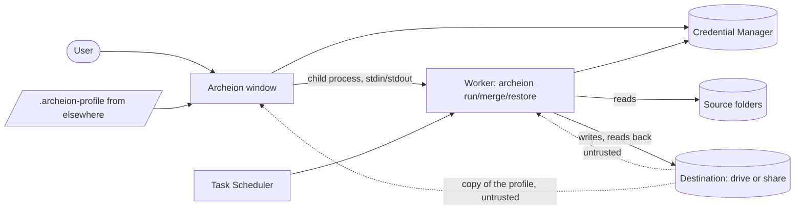

# Threat model

What Archeion protects, from whom, and what it leaves to the user. Updated
with every change to formats, trust boundaries or the handling of secrets.

## Scope

Archeion backs up folders of one Windows user to a destination folder (a
local or removable drive, or a network share), restores them, merges and
checks the backups. It runs as that user, never elevated. Out of scope:
cloud storage, other users' files, backups of the system itself.

## Assumptions

| Assumption | Broken when |
| --- | --- |
| The PC and the user's account are not compromised. | Malware runs as the user: it reads the sources and the saved password anyway. |
| The destination may be read, changed or deleted by others (a NAS, a drive lent or lost, another PC on the network). | — (this is the case designed for) |
| Windows' Credential Manager keeps the saved password for this user only. | Another program running as the user reads it. |
| Profile files (`.archeion-profile`) may come from someone else. | — |
| The copy of the profile kept at the destination may have been written by someone else, like the rest of the destination. | — |
| The toolchain, crates.io and GitHub Actions are trustworthy. | A dependency or action is compromised (mitigated by `cargo deny`, the lock file, pinned actions). |

## Assets

| Size | Asset |
| --- | --- |
| XL | The master key of an encrypted destination, shown as the recovery key; the password that unlocks it. |
| L | The user's files and their names, in the sources and in the backups. |
| L | The integrity of what a restore writes, and where it writes it. |
| M | The history of versions (being able to go back in time). |
| S | Settings, logs (they name files, never contents or secrets). |

## Trust boundaries and data flows

Boundaries: the destination (untrusted), imported profile files and the
copy of the profile read from a folder of backups (untrusted), the
worker's command line and standard input (from the window or Task
Scheduler, same user), Credential Manager.

## Threats and responses

| Threat (STRIDE) | Where | Response |
| --- | --- | --- |
| Tampering: a manifest key leads a restore outside the chosen folder (`..`, `C:\x` segments) | destination | Keys are checked when a manifest is read: only plain names under a drive, `UNC` or `ROOT` (`keys::check`). |
| Tampering: an encrypted destination's description is stripped so that backups go on in the clear | destination | A destination with backups that no longer says it is encrypted, while the profile or its archives are, is refused (`EncryptionMissing`). |
| Tampering: a plain archive, manifest, zip entry or wrapped master key put in an encrypted destination | destination | With keys, only sealed manifests and vault files are read, and plain zip entries are refused; restores check every file's BLAKE3 hash from the encrypted manifest. |
| Tampering: backups removed, swapped or put back from an old copy | destination | Encrypted destinations sign the list of archives (keyed BLAKE3), checked when the destination is opened: a backup, merge or deletion that finds another list notifies the user (and the check reports it); recovering an interrupted run signs again only a list signed before the run began. This computer also remembers the newest backup seen and warns when the destination goes back. |
| Information disclosure: names and contents read at the destination | destination | AES-256 (WinZip AE-2) zips keyed by a random master key; file names are keyed hashes; chunk names are keyed MACs. The master key is wrapped with Argon2id (64 MiB, 3 passes) of the password. |
| Information disclosure: EFS files saved in the clear | sources | Counted and shown in the backup summary with the advice to encrypt the destination. |
| Denial of service: huge or compressed-bomb manifests | destination | Manifests are read with a 4 GiB limit; chunks with their declared size; the description, key file, signature and merge journal with 1 MiB; a resume journal larger than 4 GiB starts again. |
| Denial of service: a stored file that unpacks to far more than listed fills the disk during a restore | destination | A restored file is written up to the size its manifest lists, then refused. |
| Tampering: entries marked as excluded so that a folder restore leaves them out | destination | Encrypted manifests cannot be changed; on an unencrypted destination this is part of the accepted risk below. |
| Elevation / confused deputy: a merge journal put at the destination names folders of the computer, so that recovering the "interrupted merge" renames and deletes them | destination | The journal names archives (`ArchiveName`) or it is not read; recovery touches only `<archive>.old`, `.merging` and `.deleting` folders of the destination, and never removes the only copy of a backup: an `.old` member goes only once the backup in its place reads, an unreadable merged backup is set aside as `.damaged` (named by the check, never removed). |
| Elevation / confused deputy: a junction or symbolic link put in a backup or in an unfinished backup, so that a run writes over the user's files (the sources being backed up) or a merge copies files of the computer into the destination | destination | Links are not followed: an unfinished backup holding one is not resumed, folders that are links are not backups, and a plain file is read only when its real path (`GetFinalPathNameByHandleW`) is inside the destination. Encrypted files open only with the key. |
| Elevation / confused deputy: an imported profile backs up the user's files to someone else's share on a schedule | profile files | An imported profile's schedule stays paused until the user turns it on. |
| Information disclosure: an imported profile naming `\\someone\share` makes Windows sign in there (NTLM) as soon as the settings show it | profile files | Folders on other computers of an imported profile are not touched (one guard in the engine, `destination_of`) until the user confirms the computers named. Every folder not on a drive of this computer counts (`//server/x`, `\\.\UNC\…`, `\??\UNC\…`, other device paths: `remote_part`). |
| Spoofing: an imported profile takes the id of a profile deleted before, whose password is still saved, and points it at someone else's destination | profile files | An import forgets any password saved for the id it keeps, and does not take the id of a profile whose Undo is still offered. |
| Tampering / elevation: the copy of the profile at the destination is changed so that importing it backs up other folders, or to another computer | destination | The copy is read only by File > Import profile from backups, on a folder the user chose; it goes through the same guards as a profile file (schedule paused, other computers to confirm). Its destination is the folder chosen, never the one the copy names, and its id is the owner the destination's description names. An encrypted destination is read from its sealed copy only (a plain one put there is not read, and the next backup removes it); a sealed copy from another destination does not open. |
| Information disclosure: the copy of the profile names the source folders | destination | At an encrypted destination it is sealed like the manifests (`archeion.profile.zip`); at an unencrypted one it says no more than the manifests already do. The password is never in it. |
| Denial of service: a huge copy of the profile | destination | Read up to 1 MiB, and a sealed one unpacked up to 1 MiB. |
| Information disclosure: a password given on the command line is visible to other programs | command line | `archeion extract` takes secrets only from standard input or the environment. |
| Spoofing: a weak password chosen for an encrypted destination | settings | At least 15 characters, no composition rules, common passwords and the profile name refused, an estimated strength required; at most 1024 characters so that Credential Manager keeps it. |
| Elevation: programs or libraries planted next to the portable exe | program folder | Windows programs are started by full path; libraries load only from System32 and the program's folder. |
| Repudiation / silent failure | all | Every run has a log; failures of automatic runs are notified; an incremental touching far more files than usual is notified (ransomware). |

## Accepted risks

- **Deletion.** Whoever can write to the destination can delete the
  backups; Archeion cannot prevent it (restic and Borg cannot either).
  Revisit if an append-only remote copy is added.
- **Unencrypted destinations are trusted** for content: a planted file
  with a matching manifest entry is restored. Encrypt the destination
  when others can write to it. They are never trusted for where Archeion
  reads or writes on the computer (journal names, links).
- **Backups changed outside are told once.** The run that finds another
  list than the signed one notifies the user, then goes on and signs the
  list it found; refusing would need a way to accept a destination put
  back on purpose. After an interrupted merge on exFAT or a share, where
  the journal itself can be lost, the list left may match no signed line:
  the next run then tells about a change that Archeion made.
- **Chunk files are linked by name** during a merge, without the real-path
  check of whole files: a junction could make a merge copy a file of the
  computer only if its name is a 64-digit hex hash. Chunks are checked
  against their names when read.
- **WinZip AE-2** authenticates each entry's data but not its metadata,
  and checks the MAC only at the end of the entry; Archeion compensates
  with the hashes in the encrypted manifest and temporary files renamed
  only once checked. Kept for recovery by hand with 7-Zip.
- **Sizes of encrypted files** stay visible (one zip per file, chunks of
  64 MiB at most).
- **An older copy of the profile** put back at an encrypted destination
  (sealed with the same key) is imported as it is: its rules are older,
  and the user sees them in the settings before turning the schedule on.
  On an unencrypted destination anyone who can write there chooses the
  rules imported, with the same guards.
- **Memory.** Passwords and keys are wiped when dropped, but egui keeps
  copies of text being typed while the field is open, and the `argon2`
  crate does not wipe its working memory.
- **Other users of the same computer** can make the window show itself
  through its local port (`window.port`); nothing else.

## Alternatives rejected

- A single encrypted pack format (restic-like): hides sizes better but
  can no longer be opened by hand with 7-Zip; rejected for recoverability.
- Running as a service with backup privileges (VSS): would read locked
  files, but needs an elevated helper; postponed (see `TIDY.md`).
